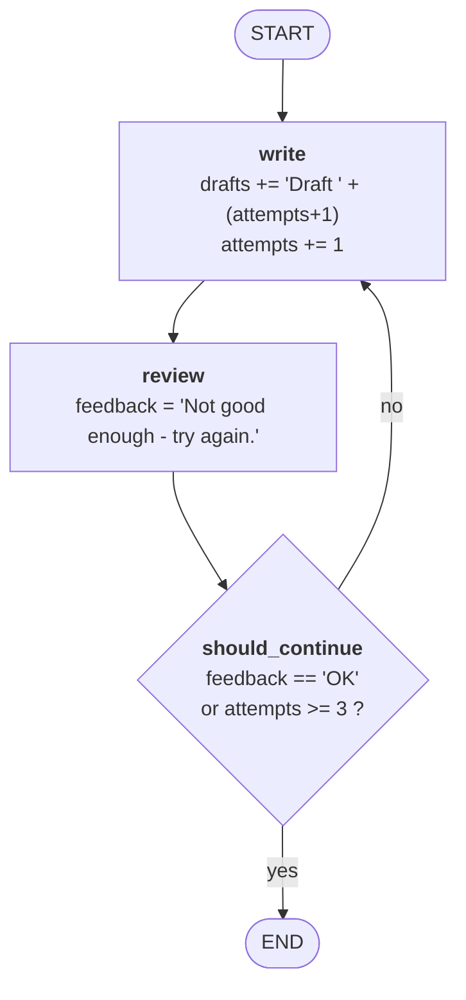
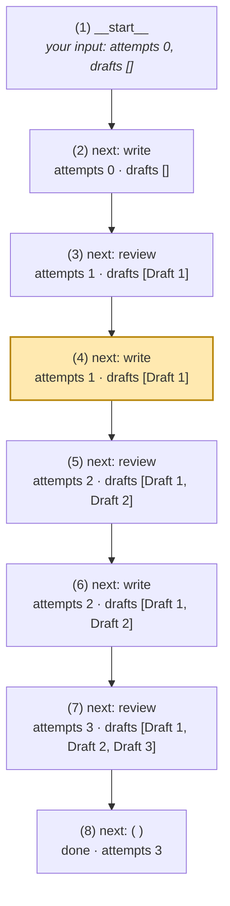
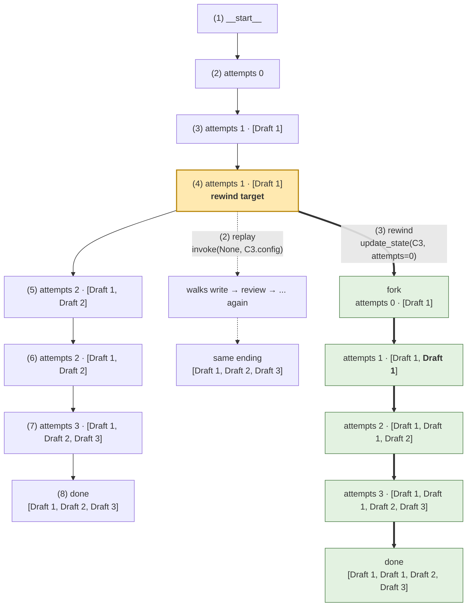
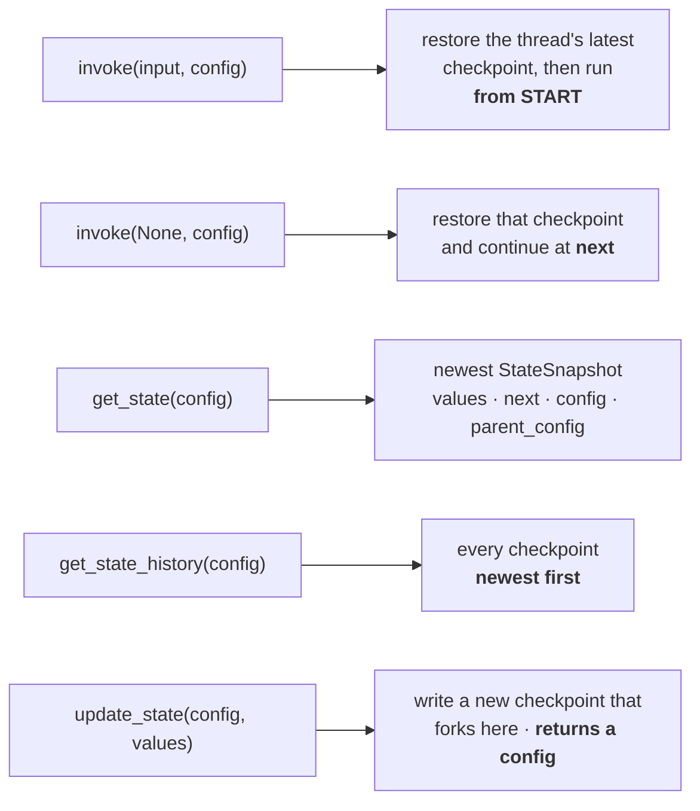

# Example 3 — diagrams

Three views of `example3_time_travel.py`, from shape to behaviour.

---

## 1. The graph shape

What `build_graph()` compiles. Nothing here is about persistence — this is the same loop shape as Session 1.

`should_continue` is a router, not a node. It has no state of its own and returns a name, not an update.
The `path_map={"write": "write", END: END}` is what gives both branches a label in the Mermaid output.

---

## 2. The checkpoint timeline of the original run

`graph.invoke({...}, config)` writes **8 checkpoints**. Read top to bottom.

Two things to read off it:

- **`next` says where the run would continue.** `( )` means finished. This is the field that makes resume possible.
- Checkpoint **(4)** is the one the code picks: `next == ("write",)` and `attempts == 1`. It is highlighted.
- The run stops at **(7)**, not by writing a fourth draft: `attempts` is already 3 when `should_continue` is asked, so it returns `END`.

---

## 3. The fork — replay vs rewind

Both start from checkpoint **(4)**. One changes nothing; the other edits the state first.

The duplicate **`Draft 1`** is the whole proof: after `update_state` sets `attempts` back to `0`, `write`
recomputes `OFFLINE_DRAFTS[0]` and appends it to a `drafts` list that still holds the first one. The
`operator.add` reducer keeps both.

The solid chain is never touched. `update_state` did not delete or edit checkpoint (4) — it wrote a **new**
checkpoint whose `parent_config` points at (4), and returned the config that addresses it.

### How the history grows

| After | Checkpoints | Added |
|---|---|---|
| original run | 8 | — |
| replay | 13 | +5 |
| `update_state` | 14 | +1 (the fork) |
| rewound run | **20** | +6 |

`graph.get_state_history(config)` now returns 20 entries, newest first. Both branches are in that flat list —
`parent_config` is what recovers the tree.

---

## 4. The five calls, as a cheat sheet

The distinction in the first two rows is the one that gets misremembered: a checkpointer does not make
`invoke` resume mid-graph. It restores **state**. Continuing at `next` is a separate, explicit call.
